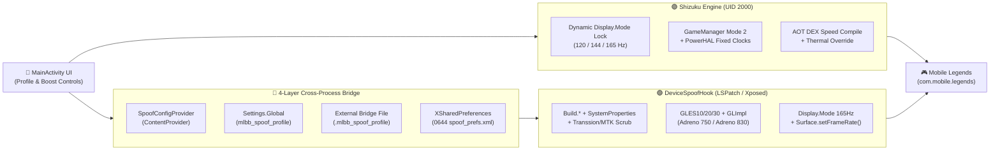

<div align="center">

# ⚡ MLBB 165 FPS Unlocker & Deep Spoofer 🚀
### *Dynamic Hardware Hz Controller • PowerHAL Performance Engine • Deep Device & GPU Spoofer*

[-00E676?style=for-the-badge&logo=android&logoColor=white)](https://github.com/gailowilly551-afk/mlbb-fps-booster)
[-38BDF8?style=for-the-badge&logo=linux&logoColor=white)](https://shizuku.rikka.app/)
[](https://github.com/LSPosed/LSPatch)
[](https://github.com/gailowilly551-afk/mlbb-fps-booster)
[](https://github.com/gailowilly551-afk/mlbb-fps-booster)

<p align="center">
  <b>Package:</b> <code>com.fpsbooster.mlbb</code> &nbsp;•&nbsp;
  <b>Target App:</b> <code>com.mobile.legends</code> &nbsp;•&nbsp;
  <b>Download APK:</b> <a href="app/build/outputs/apk/debug/MLBB-165FPS-Booster-v1.0.0.apk"><b>MLBB-165FPS-Booster-v1.0.0.apk</b></a>
</p>

</div>

---

## 🌟 Ano ang Kayang Gawin ng App na Ito? (Key Highlights)

| 🛠️ Engine / Module | 🔥 Main Capabilities |
| :--- | :--- |
| **🟢 Shizuku Real FPS Engine**<br>*(No Root / No APK Patch)* | • Auto-detects ang totoong peak hardware `Display.Mode` (`width`, `height`, `modeId`, at exact float `Hz`)<br>• Bina-bypass ang **Transsion (TECNO / Infinix / Itel HiOS)**, Xiaomi HyperOS, at ColorOS refresh-rate & thermal caps<br>• Ina-activate ang Android 12–16 `GameManager` Performance Mode (`mode=2`) + `loadingBoost` |
| **⚡ PowerHAL & Anti-Lag Engine**<br>*(Teamfight FPS Stability)* | • Ni-la-lock ang sustained CPU/GPU clocks via `cmd power set-fixed-performance-mode-enabled true`<br>• Pinipigilan ang thermal FPS drop via `cmd thermalservice override-status 0`<br>• Nagpapatakbo ng **AOT DEX `speed` Compilation** (`cmd package compile -m speed -f`) para walang JIT stutter sa 5v5 clash |
| **🟣 Deep Device & GPU Spoofer**<br>*(LSPatch / LSPosed Hook)* | • Naka-spoof ang buong `android.os.Build.*`, `SystemProperties.get/native_get`, at Transsion/MTK properties<br>• Naka-hook ang OpenGL ES `GLES10/20/30` + `GLImpl` (`GL_VENDOR` at `GL_RENDERER` $\rightarrow$ **Adreno 750 / Adreno 830**)<br>• Naka-hook ang `Display.getRefreshRate()`, `Display.Mode.getRefreshRate()`, at `Surface.setFrameRate()` (`165.0 Hz`) |
| **🔗 4-Layer Config Sync Bridge**<br>*(Android 11–16 Compatible)* | • Automatic sync sa pagitan ng App UI at MLBB via:<br>&nbsp;&nbsp;1️⃣ `SpoofConfigProvider` (`content://com.fpsbooster.mlbb.provider/config`)<br>&nbsp;&nbsp;2️⃣ `Settings.Global` (`mlbb_spoof_profile` & `device_name`)<br>&nbsp;&nbsp;3️⃣ External App Bridge (`/Android/data/com.mobile.legends/files/.mlbb_spoof_profile`)<br>&nbsp;&nbsp;4️⃣ World-Readable `XSharedPreferences` (`0644`) |

---

## 🤔 Kailangan pa ba i-download ang Latest LSPatch?

Depende sa setup at goal mo—**pwede itong gamitin nang WALANG LSPatch**, o **KASAMA ang LSPatch / LSPosed**:

| 🎮 Mode ng Paggamit | 📥 Kailangan ba ng LSPatch? | 🎯 Ano ang Nagagawa? | 🛡️ Account Safety |
| :--- | :---: | :--- | :--- |
| **🟢 Mode 1: Shizuku Only**<br>*(Recommended Safe Mode)* | ❌ **HINDI KAILANGAN**<br>*(Shizuku app lang)* | Ni-la-lock ang physical screen sa max hardware Hz (`120Hz` / `144Hz` / `165Hz`), tinatanggal ang OEM thermal/refresh caps, sine-set ang `device_name`, at bino-boost ang CPU/GPU + AOT Speed Compile. | ✅ **100% SAFE SA MAIN ACCOUNT**<br>*(Zero APK modification)* |
| **🟠 Mode 2: Shizuku + LSPatch**<br>*(No-Root Deep Spoof)* | ✅ **OO KAILANGAN**<br>*(LSPatch v0.6 / JingMatrix v0.7+)* | Ini-inject ang `DeviceSpoofHook` sa loob ng MLBB para ma-spoof ang modelo + GPU (`Adreno 750` / `Adreno 830`) at lumabas ang nakatagong **Ultra (120/144/165 FPS)** setting sa MLBB. | ⚠️ **GAMITIN MUNA SA SMURF / DUMMY**<br>*(Napapalitan ang APK signature kapag naka-LSPatch)* |
| **🔵 Mode 3: LSPosed + Shizuku**<br>*(Para sa Rooted Phones)* | ❌ **HINDI KAILANGAN**<br>*(LSPosed Manager ang gamit)* | Systemless hook sa `com.mobile.legends` nang hindi binabago ang APK signature ng MLBB, kasabay ng Shizuku hardware Hz lock. | ✅ **MAS SAFE KAYSA LSPATCH**<br>*(Original APK signature stays intact)* |

> [!TIP]
> **Kailan sapat na ang Mode 1 (Shizuku Only)?**
> Kung meron ka nang **High (60)**, **Super (90)**, o **Ultra (120+)** sa MLBB Settings pero bumabagsak sa 60Hz ang screen mo o nag-fre-frame drop kapag umiinit sa clash, **Shizuku Only Mode (Mode 1)** lang ang kailangan mo!

---

## 📖 Paano Gamitin ang APK (Step-by-Step Guide)

### 🟢 Paraan 1: Shizuku Only Mode (Walang Root • Walang LSPatch • 100% Safe)

1. 📲 **I-install ang Apps:**
   - I-install ang **Shizuku** (mula sa Play Store o GitHub) at ang **[MLBB-165FPS-Booster-v1.0.0.apk](app/build/outputs/apk/debug/MLBB-165FPS-Booster-v1.0.0.apk)**.
2. 📡 **I-start ang Shizuku via Wireless Debugging:**
   - Buksan ang **Developer Options** $\rightarrow$ i-on ang **USB Debugging** at **Wireless Debugging**.
   - Sa **Shizuku** app, i-tap ang **Pairing** $\rightarrow$ ilagay ang 6-digit pairing code mula sa Wireless Debugging $\rightarrow$ i-tap ang **Start**.
3. 🚀 **I-activate ang Real FPS & Performance Boost:**
   - Buksan ang **MLBB 165FPS Booster** app.
   - Sa **Card 2**, i-tap ang **`REQUEST SHIZUKU PERMISSION`** $\rightarrow$ piliin ang **Allow all the time**.
   - Sa **Card 3**, piliin ang target profile mo (`ASUS_AI2401_A`, `ASUS_AI2501`, o `NX769J`).
   - Sa **Card 2**, i-tap ang **`APPLY FULL SPOOF + REAL MAX FPS + BOOST (SHIZUKU)`**.
   - I-tap ang **`AOT SPEED COMPILE + RAM & POWERHAL BOOST (ANTI-LAG)`** at hintayin matapos (`10–25 seconds`).
   - *(Optional)* Kung kapos ang GPU sa mabibigat na 5v5 Lord fights, i-tap ang **`90% Smooth`** o **`85% Max FPS`**.
4. 🎮 **Maglaro:** I-tap ang **`OPEN MOBILE LEGENDS`**!

---

### 🟠 Paraan 2: Full Deep Spoof via LSPatch + Shizuku (Para Lumabas ang Hidden Ultra FPS, No Root)

> [!IMPORTANT]
> **Aling LSPatch Version ang Dapat I-download?**
> - **Android 10 hanggang Android 13:** Official **LSPatch v0.6** (`manager-v0.6-398-release.apk`).
> - **Android 14 / Android 15 / Android 16:** Gamitin ang updated **JingMatrix / Vector LSPatch v0.7+** build na may full support sa Android 14–16 (`targetSdk 35`).

1. 🔧 **I-authorize ang LSPatch sa Shizuku:**
   - Siguraduhing running ang **Shizuku**, buksan ang **LSPatch**, at bigyan ito ng Shizuku permission.
2. 📦 **I-patch ang Mobile Legends APK:**
   - Sa **LSPatch**, pumunta sa **Manage** tab $\rightarrow$ i-tap ang **`+` (New Patch)** button $\rightarrow$ **Select an installed app** $\rightarrow$ piliin ang **Mobile Legends: Bang Bang**.
   - Piliin ang **Patch Mode: `Local` (Recommended)** para pwede kang magpalit ng device profile sa loob ng booster app kahit kailan nang hindi nagre-repatch!
   - I-tap ang **Start Patch** $\rightarrow$ kapag tapos na, i-tap ang **Install** (mag-u-uninstall muna ang lumang MLBB at ii-install ang patched version).
3. 🔗 **I-link ang Module Scope:**
   - Sa **LSPatch** $\rightarrow$ **Manage** tab $\rightarrow$ i-tap ang **Mobile Legends: Bang Bang** $\rightarrow$ **Module Scope** $\rightarrow$ i-check ang **`MLBB 165FPS Booster`** (`com.fpsbooster.mlbb`).
4. ⚡ **Piliin ang Profile at I-lock ang Hz:**
   - Buksan ang **MLBB 165FPS Booster** app.
   - Sa **Card 3**, piliin ang gusto mong 165Hz Flagship Profile.
   - I-tap ang **`VERIFY & PREVIEW SPOOF PAYLOAD`** para ma-check sa console ang `Build.*` at `GL_RENDERER` values.
   - Sa **Card 2**, i-tap ang **`APPLY FULL SPOOF + REAL MAX FPS + BOOST (SHIZUKU)`** para i-lock ang screen mo sa max Hz at i-sync ang bridge files.
5. 🏆 **I-enable ang Ultra FPS sa MLBB:**
   - Buksan ang **Mobile Legends** $\rightarrow$ **Settings** $\rightarrow$ **Graphics** $\rightarrow$ **Frame Rate** $\rightarrow$ piliin ang **Ultra**!

> [!WARNING]
> **Tip sa Pag-login sa Patched MLBB:** Dahil nabago ang APK signature sa LSPatch, gamitin ang **Moonton Account** sa pag-login (o kung **Facebook Account**, i-disable/uninstall muna ang Facebook app para sa Chrome/Browser mag-login).

---

### 🔵 Paraan 3: LSPosed + Shizuku (Para sa Rooted Devices)

1. Buksan ang **LSPosed Manager** $\rightarrow$ **Modules** $\rightarrow$ i-enable ang **`MLBB 165FPS Booster`**.
2. I-check sa **Module Scope** ang:
   - ☑️ **Mobile Legends: Bang Bang** (`com.mobile.legends`)
   - ☑️ **MLBB 165FPS Booster** (`com.fpsbooster.mlbb`)
3. Buksan ang **MLBB 165FPS Booster**, piliin ang profile sa **Card 3**, at i-tap ang **`APPLY FULL SPOOF + REAL MAX FPS + BOOST (SHIZUKU)`** sa **Card 2**.
4. I-Force Stop ang Mobile Legends at buksan ulit!

---

## 📱 Built-in 165Hz Flagship Profiles (`SpoofProfiles`)

| 🏷️ Profile ID | 📱 Spoofed Device Name | 🧠 SoC / Chipset | 🎨 OpenGL ES GPU (`GL_RENDERER`) | ⚡ Target Hz |
| :--- | :--- | :--- | :--- | :---: |
| **`ASUS_AI2401_A`** | **ROG Phone 8 Pro** | Qualcomm `SM8650` (SD 8 Gen 3) | `Adreno (TM) 750` | **165 Hz** |
| **`ASUS_AI2501`** | **ROG Phone 9 Pro** | Qualcomm `SM8750` (SD 8 Elite) | `Adreno (TM) 830` | **165 Hz** |
| **`NX769J`** | **RedMagic 9 Pro** | Qualcomm `SM8650` (SD 8 Gen 3) | `Adreno (TM) 750` | **165 Hz** |

---

## 🎛️ Gabay sa Lahat ng Buttons sa Loob ng App

| 🔘 Button sa UI | ⚙️ Ano ang Ginagawa sa System |
| :--- | :--- |
| **`REFRESH LIVE MONITOR`** | Nagre-refresh ng live display Hz, active `modeId`, `device_name`, at `mlbb_spoof_profile` sync status. |
| **`REQUEST SHIZUKU PERMISSION`** | Humihingi ng `UID 2000` shell access mula sa Shizuku service. |
| **`APPLY FULL SPOOF + REAL MAX FPS + BOOST`** | 1-Tap All-in-One: Syncs 4-layer spoof bridge + locks exact hardware peak `Display.Mode` + bypasses Transsion/OEM thermal caps + activates `GameManager` mode 2 + enables `PowerHAL` Fixed Performance Mode. |
| **`LOCK NATIVE HARDWARE PEAK (<Hz> EXACT)`** | Direktang ni-la-lock ang screen sa pinakamataas na native refresh rate (`120Hz` / `144Hz` / `165Hz`) na suportado ng panel mo. |
| **`AOT SPEED COMPILE + RAM & POWERHAL BOOST`** | Nagpapatakbo ng `cmd package compile -m speed -f com.mobile.legends` + `am kill-all` para walang lag o frame drop sa 5v5 clash. |
| **`100% Native` \| `90% Smooth` \| `85% Max FPS`** | Nagse-set ng legal Android `GameManager` resolution scaling para bawasan ang GPU load kapag mabigat ang teamfight. |
| **`CHECK REAL FPS (GFXINFO) & SYSTEM CONFIG`** | Kinukuha ang totoong rendered frames at janky frame % ng MLBB mula sa `dumpsys gfxinfo com.mobile.legends`. |
| **`VERIFY & PREVIEW SPOOF PAYLOAD`** | Ipinapakita sa log console ang eksaktong `Build.*`, `SystemProperties`, `GL_VENDOR`, at `GL_RENDERER` na matatanggap ng MLBB. |
| **`RESET ALL TO DEFAULT`** | Ibinabalik sa original hardware model ang `device_name`, tinatanggal ang refresh rate locks, at nire-reset ang thermal/power states. |

---

## 🏗️ System Architecture



---

## 🛠️ Build from Source

Requires **JDK 17** and **Gradle 8.6** (`compileSdk 35`, `minSdk 29`, `targetSdk 35`):

```bash
JAVA_HOME=/usr/lib/jvm/java-17-openjdk-amd64 /opt/gradle-8.6/bin/gradle clean lintDebug assembleDebug
```

- 📦 **Compiled APK:** [`app/build/outputs/apk/debug/MLBB-165FPS-Booster-v1.0.0.apk`](app/build/outputs/apk/debug/MLBB-165FPS-Booster-v1.0.0.apk)
